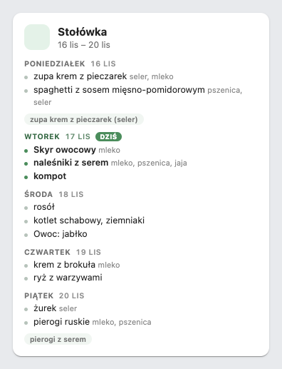

# e-Stołówka dla Home Assistanta

[](https://github.com/parfienczyk/ha-e-stolowka/actions/workflows/validate.yml)
[](https://github.com/parfienczyk/ha-e-stolowka/actions/workflows/security-audit.yml)
[](https://hacs.xyz/docs/faq/custom_repositories/)
[](https://github.com/parfienczyk/ha-e-stolowka/releases)
[](LICENSE)

**Jadłospis szkolnej stołówki w Home Assistancie.** Integracja czyta menu
z platformy **e-Stołówka** ([loca.pl](https://loca.pl)) i pokazuje je jako encje:
na dziś, na jutro i na cały pobrany tydzień, razem z alergenami i wariantami
dietetycznymi.



> Projekt społecznościowy, niepowiązany z loca.pl ani z żadną szkołą.

## Jak to działa

loca.pl nie ma publicznego API. Szkoła publikuje jadłospis jako wpis
w aktualnościach, po jednym na tydzień, a zakres dat jest w adresie
(`/sites/jadlospis-280926-021026,1946`). Integracja loguje się formularzem
rodzica, bierze bieżący tydzień i następny (żeby „jutro" działało też w piątek)
i tylko te wpisy pobiera.

Dni w treści rozdziela nagłówek w rodzaju **PONIEDZIAŁEK 28.09.26**. Wiersze
`DIETA:` trafiają na osobną listę, alergeny zostają w nazwach potraw. Układ
tabelaryczny też jest czytany. Wygasła sesja jest odnawiana, a złe hasło
uruchamia w Home Assistantzie ponowne logowanie.

## Instalacja

### HACS (zalecane)

1. HACS → **Integracje** → menu ⋮ → **Custom repositories**
2. Dodaj `https://github.com/parfienczyk/ha-e-stolowka`, kategoria **Integration**
3. Zainstaluj **e-Stołówka (loca.pl)** i zrestartuj Home Assistanta

### Ręcznie

Skopiuj `custom_components/e_stolowka` do `config/custom_components/`
i zrestartuj Home Assistanta.

## Konfiguracja

**Ustawienia → Urządzenia i usługi → Dodaj integrację → e-Stołówka**

| Pole | Opis |
| --- | --- |
| Adres e-Stołówki | `https://` Twojej szkoły, np. `https://sobolewosp.loca.pl` |
| E-mail | konto rodzica |
| Hasło | hasło do tego konta |

Odświeżanie ustawisz w **Opcjach** (domyślnie raz na dobę, zakres 1–24 godziny).
Adres musi być `https://`.

## Encje

Nazwa bierze się ze szkoły w adresie. Dla `sobolewosp.loca.pl`:

| Encja | Stan | Atrybuty |
| --- | --- | --- |
| `…_jadlospis_na_dzis` | dania w jednej linii | `data`, `potrawy`, `dieta`, `jadlospis` |
| `…_jadlospis_na_jutro` | dania w jednej linii | `data`, `potrawy`, `dieta`, `jadlospis` |
| `…_jadlospis_tygodniowy` | liczba dni z menu | `poczatek_tygodnia`, `koniec_tygodnia`, `dni` |

Stan encji mieści 255 znaków, więc pełna lista jest w atrybutach. W weekend,
święto i ferie sensory dzienne mają stan `unknown`.

## Karta Lovelace

Gotowa karta jest w [`lovelace/`](lovelace/). HACS jej nie instaluje razem
z integracją (repozytorium ma jedną kategorię: Integration).

1. Skopiuj `lovelace/e-stolowka-card.js` do `config/www/`
2. **Ustawienia → Dashboardy → ⋮ → Zasoby → Dodaj zasób**
   URL `/local/e-stolowka-card.js`, typ **Moduł JavaScript**
3. Odśwież przeglądarkę twardo (`Ctrl/Cmd + Shift + R`)
4. Dodaj kartę **e-Stołówka**

Sensor wybierasz z listy. Karta sama podpowiada pierwszy sensor tygodniowy,
alergeny z nawiasów pokazuje przygaszone, a dzisiejszy dzień wyróżnia.
Rozpoznaje też tryb ciemny.

```yaml
type: custom:e-stolowka-card
entity: sensor.e_stolowka_sobolewosp_jadlospis_tygodniowy
title: Stołówka
range: week      # week | all | today
show_diet: false
compact: false
```

Te same atrybuty da się wkleić w kartę markdown (`potrawy`, `dieta`, `dni`).

## Powiadomienie

Blueprint wysyła jadłospis o **7:30** na wybraną encję `notify`. Tuż przed
wysłaniem odświeża menu. Gdy na ten dzień nie ma potraw, nic nie wychodzi.
Domyślnie tylko poniedziałek–piątek. Warianty `DIETA:` włącza się przełącznikiem.

HACS go nie instaluje. Wklej adres w **Ustawienia → Automatyzacje i sceny →
Blueprinty → Importuj blueprint**:

```text
https://github.com/parfienczyk/ha-e-stolowka/blob/main/blueprints/automation/e_stolowka/powiadomienie_jadlospis.yaml
```

Sensor w blueprintcie to **Jadłospis na dziś**, nie tygodniowy.

## Inna szkoła

Wystarczy adres swojej szkoły. Gdy jadłospis nie zostanie znaleziony, układ
strony jest inny niż ten, który parser zna. Skrypt diagnostyczny zapisuje
strony do `dump/` (katalog jest w `.gitignore` i może zawierać dane dziecka):

```bash
pip install -r requirements-test.txt
cp .env.example .env    # adres, e-mail i hasło; .env nie trafia do gita
python3 scripts/explore.py
```

Zmienne `STOLOWKA_URL`, `STOLOWKA_EMAIL` i `STOLOWKA_PASSWORD` mają
pierwszeństwo przed plikiem. Potem otwórz
[zgłoszenie](https://github.com/parfienczyk/ha-e-stolowka/issues) — dopiszemy szkołę na stałe.

## Rozwój

```bash
pip install -r requirements-test.txt
pytest tests/ -q
ruff check . && ruff format --check .
```

## Prywatność

Hasło idzie tylko na serwer szkoły, po `https://`, i zostaje w konfiguracji
Home Assistanta na Twoim urządzeniu. Każdy wpis ma własną sesję. Nie ma
telemetrii. Szczegóły: [SECURITY.md](SECURITY.md).

## Dokumenty

- [CONTRIBUTING.md](CONTRIBUTING.md) — jak pomóc i jak dodać kolejną szkołę
- [SECURITY.md](SECURITY.md) — dane logowania i czego nie wysyłać publicznie
- [CHANGELOG.md](CHANGELOG.md) — historia zmian

## Licencja

[MIT](LICENSE)
